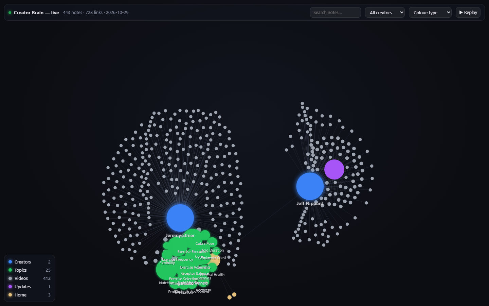
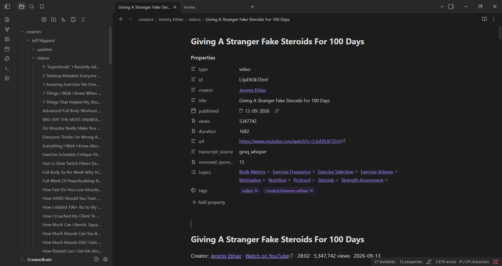
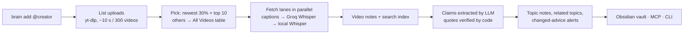

<div align="center">

# 🧠 Creator Brain

**Turn any YouTube creator into a living knowledge base your AI can actually use.**

Transcripts → verified claims with timestamps → linked topics → an Obsidian vault + an MCP server
that Claude Code, Codex, Cursor and Gemini CLI can build, search and keep up to date.


<sub>Two brains (Jeremy Ethier, Jeff Nippard) in one vault — creators blue, topics green, videos grey. `brain graph` shows it live and can replay how it grew.</sub>

</div>

---

## Why

You learn from a few creators you trust. Their best advice is spread over hundreds of videos.
Creator Brain pulls it all into one place **with receipts**: every piece of advice links to the exact second
in the video, and code (not the AI) checks that the quote really is in the transcript.

## What you get

| | |
|---|---|
| ⚡ **Fast, never stuck** | Parallel fetch lanes (your IP, paced, + verified proxies). Captions → Groq Whisper → local Whisper. A durable queue resumes after any crash. |
| ✅ **Accurate** | Claims are extracted by an LLM, then **verified by code** against the transcript (numbers and "not" must match). Whisper is always told the language. |
| 🔗 **Linked** | Video ↔ topics ↔ creators. Topics are shared across creators, so you see where experts agree or disagree. |
| 🔄 **Self-updating** | A cheap new-video check once a day; update notes list new advice and ⚠️ changed advice. |
| 📚 **Whole channel on tap** | Default brain = newest 30 % + top 10 winners. Every other upload sits in an *All Videos* table, one call away. |
| 🖥️ **See it** | Obsidian graph view, and a live animated graph in your browser. |
| 🤖 **Any agent** | MCP server + CLI + `AGENTS.md` in the vault + a ready-made agent skill (`skills/creator-brain/SKILL.md`). |

<div align="center">


<sub>A video note: properties link the creator and topics; below come Key points (claim · timestamp · topic) and the transcript.</sub>

</div>

## Quick start

```bash
git clone https://github.com/LikithMeruvu/creator-brain && cd creator-brain
uv venv && uv pip install -e .          # Python 3.11+
brain setup                              # optional: Groq key, proxy list, free proxies, local Whisper
brain add @JeremyEthier                  # newest 30% + top 10 winners  (add --full for every video)
brain status                             # progress per creator
brain search "how many sets per week for muscle growth"
brain graph                              # live animated graph in your browser
```

Open the vault folder (`~/CreatorBrain`, or set `CBRAIN_VAULT`) in Obsidian to browse it.

## Connect your AI (MCP)

| Harness | Setup |
|---|---|
| **Claude Code** | `claude mcp add creator-brain --scope user -- brain-mcp` |
| **Codex CLI** | `~/.codex/config.toml` → `[mcp_servers.creator-brain]` `command = "brain-mcp"` |
| **Cursor / Windsurf** | MCP settings → new server `creator-brain`, command `brain-mcp` |
| **Gemini CLI** | `settings.json` → `"mcpServers": {"creator-brain": {"command": "brain-mcp"}}` |

Give the agent the playbook too: copy `skills/creator-brain/` into your skills folder
(Claude Code: `~/.claude/skills/creator-brain/`). It tells the agent how to plan, search, cite and maintain.

### MCP tools

| Tool | What it does |
|---|---|
| `add_creator(handle, full=False)` | Build a brain; returns in seconds, work continues in the background |
| `search_brain(query, creators, limit)` | Verified claims + transcript passages, each with a timestamp URL |
| `get_topic(name)` · `compare_creators(topic, creators)` | Everything on one subject; agreement / disagreement |
| `add_videos(creator, match, video_ids, top, dry_run)` | Pull more videos from the *All Videos* catalog |
| `update_creators(creator)` | Check for new uploads (also runs daily by itself) |
| `my_profile(updates)` | The user's goals, level, injuries, equipment — for personal answers |
| `save_output(title, markdown, sources)` | Save plans/answers into the vault (they join the graph) |
| `suggest_creators(topic)` | Find strong channels for a topic |
| `brain_status` · `brain_doctor(fix)` · `brain_graph` | Progress, health checks/repairs, live graph URL |

## Use cases

- **Personal coach** — *"Make me a 4-day hypertrophy plan from Jeremy Ethier. I have a bad shoulder."*
  The agent reads your profile, searches volume, frequency, exercise picks and shoulder-safe swaps, cites every
  choice, and saves the plan to `outputs/`.
- **Expert panel** — add Jeff Nippard and a nutrition channel; *"Where do they disagree on protein?"*
  Shared topic notes put each creator's view side by side.
- **Study a field** — `brain add @SomeLecturer --full`, then ask questions with second-level citations.
- **Content research** — the *All Videos* table shows every upload with views; add the winners and ask what
  hooks, formats and claims they share.

## How it works



| Part | Detail |
|---|---|
| Transcripts | Lane 0 = your IP, paced (~240 videos/h, under YouTube's ~300/h guest limit). More lanes through proxies (your own list, or verified free ones). Sponsor segments cut via SponsorBlock. |
| Queue | One SQLite job per video; leases, retries with back-off, parked with a reason after 3 failures. |
| Extraction | Groq models rotated, each with its own free quota; follows Groq's rate-limit headers; daily caps defer jobs instead of failing them. No Groq key? Your own agent extracts from `.brain/pending_extraction/`. |
| Accuracy | Exact-quote check with one tolerance (a single mis-heard word) — never for numbers or negations. Wrong-language transcripts are redone. |
| Many agents | One writer lock per vault; any number of readers. |

## The vault

```
CreatorBrain/
├── AGENTS.md          rules every agent reads
├── Home.md            dashboard: creators, % built, top topics
├── Me.md              your profile (goal, level, injuries, equipment…)
├── creators/
│   └── Jeremy Ethier/
│       ├── Jeremy Ethier.md                 brain label, stats, top topics & videos
│       ├── Jeremy Ethier - All Videos.md    every upload: ✅ in brain · ⏳ queued · ➕ not added
│       ├── videos/<Title>.md                properties · Key points · Transcript
│       └── updates/Jeremy Ethier - Update 2026-10-29.md
├── topics/<Topic>.md  per-creator claims (newest first), agree/disagree, related topics
├── outputs/           plans and answers you saved
└── .brain/            engine room: queue, search index, claims.jsonl, transcripts
```

Brain names look like `jeremy-ethier · recent · updated 2026-10-29 · 278 videos`.

## Commands

| Command | |
|---|---|
| `brain add <handle> [--full] [--shorts]` | create a brain |
| `brain more <creator> --match "words" \| --top N \| --ids a,b [--dry-run]` | add catalog videos |
| `brain update [creator]` | check for new uploads |
| `brain status` · `brain search <q>` · `brain topic <name>` · `brain compare <topic> --creator A --creator B` | read |
| `brain graph` | live animated graph (`?still` in the URL for screenshots) |
| `brain doctor [--fix]` · `brain retry` · `brain pause` / `resume` | health |
| `brain rebuild` · `brain merge-topics [--dry-run]` · `brain dates` | maintenance (pause first) |
| `brain setup` · `brain mcp` · `brain worker` | setup / run |

## Settings

`brain setup` writes `.brain/config.json`; every key can be overridden with `CBRAIN_<KEY>`.
API keys live in `~/.cbrain/secrets.json` or `GROQ_API_KEY`, never in the vault.

| Key | Default | Meaning |
|---|---|---|
| `recent_fraction` / `top_winners` | 0.30 / 10 | default brain scope |
| `lanes` | 12 | parallel fetch lanes (lane 0 = your IP) |
| `own_ip_interval_seconds` | 15 | pacing for your own IP |
| `use_free_proxies` / `proxy_file` | true / "" | proxy sources (yours are always tried first) |
| `extract_model` / `extract_fallback_models` | gpt-oss-120b / gpt-oss-20b, qwen3.8-27b | Groq models rotated for extraction |
| `asr_model` / `default_language` | whisper-large-v3-turbo / en | audio fallback; language told to Whisper |
| `whisper_upgrade_top` | 10 | top videos re-transcribed with Whisper for accuracy |
| `local_whisper` | false | use faster-whisper when Groq is missing |
| `sponsorblock` | true | cut sponsor segments |
| `daily_check_hours` | 24 | automatic new-video check |
| `cost_confirm_usd` | 1.0 | ask before a big paid extraction |

## Honest limits

- Free proxies are unreliable (~1 % of public lists fetch captions); a paid proxy list makes big channels fast.
- Groq's free tier caps tokens per minute and requests per day; big channels finish over hours, in the background.
- The quote check proves the words exist in the transcript — not that the advice is right.
- Transcripts stay on your machine. Don't redistribute creators' content.

## Develop

```bash
uv pip install -e ".[dev]" && .venv/Scripts/python -m pytest -q     # 357 tests, no network
```

Architecture and module contracts: [SPEC.md](SPEC.md). MIT licence.
